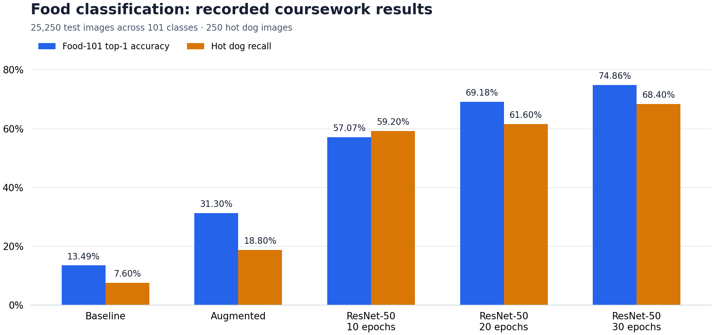
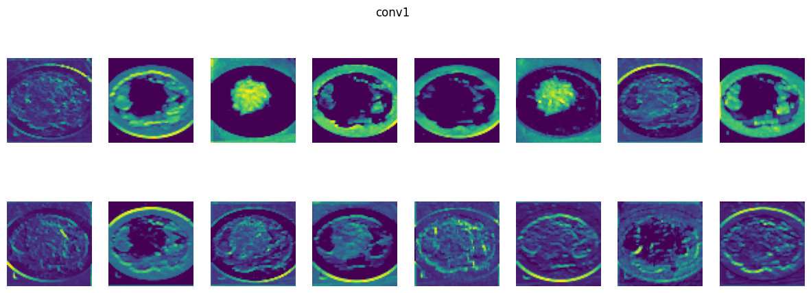
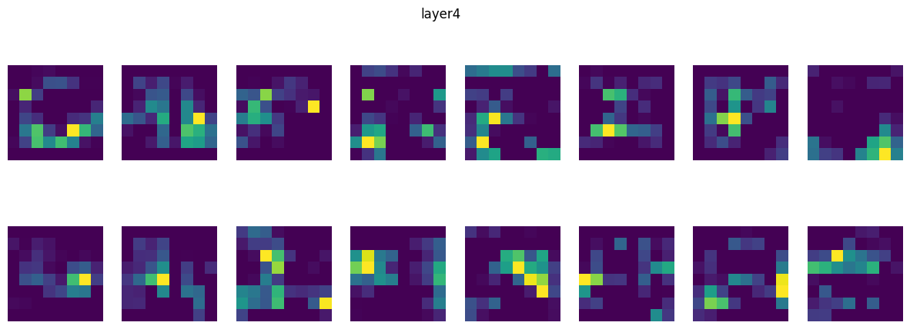

# Food-101 Classification with Custom ResNets

A PyTorch computer vision project developed for deep learning coursework at Imperial College London. The work covers implementing core neural network operations, training residual networks from scratch, and evaluating a food classifier on both real photographs and synthetic images.

The best model achieved **74.86% top-1 accuracy across 101 food classes**, up from a recorded baseline of **13.49%**. It uses a custom ResNet-50 architecture trained for 30 epochs, with data augmentation and tuned training hyperparameters.

Start with the [coursework notebook](dl_cw_1.ipynb) for the full experiments and saved outputs, [resnet503.py](experiments/resnet503.py) for the best training configuration, and [resnet_tuned30.pt](checkpoints/resnet_tuned30.pt) for its saved weights.

## Results

The following results were recorded on the **25,250-image Food-101 test split**. Hot dog recall measures how many of its 250 hot dog images were correctly assigned to class 55.

| Experiment | Top-1 test accuracy | Hot dog recall |
| :--- | ---: | ---: |
| Baseline | 13.49% | 7.60% |
| Augmented model | 31.30% | 18.80% |
| Custom ResNet-50, 10 epochs | 57.07% | 59.20% |
| Custom ResNet-50, 20 epochs | 69.18% | 61.60% |
| **Custom ResNet-50, 30 epochs** | **74.86%** | **68.40%** |



The final checkpoint correctly classified **18,902 / 25,250** test images, including **171 / 250** hot dogs. This represents a **61.37 percentage point** improvement over the baseline. The augmented run improved on the baseline, and the deeper architecture with longer training produced the strongest recorded result. These runs changed multiple factors and training budgets, so they show the progression of the project rather than a controlled ablation of each technique.

The [original results summary](results/test_accuracies.txt) records all five runs. The notebook's **Network Performance** section evaluates `loader_test` after loading `resnet_tuned30.pt`, confirming the final row. The accuracy helper prints “val set” for every loader; the 25,250-image results above are test results.

### Generalisation to synthetic hot dogs

The same 101-class model correctly identified **357 / 1,000 synthetic hot dog images (35.70%)** in the notebook's out-of-distribution evaluation. This is recall on a dataset containing only hot dogs; it does not measure binary hot dog detection accuracy or false positives on other foods.

Recall fell from 68.40% on real Food-101 hot dogs to 35.70% on the synthetic set, showing a substantial generalisation gap despite augmentation. The notebook includes the corresponding confusion matrix and examples of misclassified synthetic images.

## Approach

### Core operations

Part 1 implements the forward passes for 2D convolution, max pooling, a linear layer, and batch normalisation using basic tensor operations. Convolution uses `unfold` and matrix multiplication, while pooling uses tensor windows and a maximum reduction. All four public coursework test groups passed in the saved notebook outputs. These exercises are separate from the classifier, which uses PyTorch's standard trainable layers.

### Best classifier

The final model is implemented directly in [resnet503.py](experiments/resnet503.py), with bottleneck residual blocks arranged as **[3, 4, 6, 3]**, batch normalisation, ReLU activations, global average pooling, and a 101-class linear head. It is trained from scratch, without loading pretrained weights.

| Setting | Final configuration |
| :--- | :--- |
| Trainable parameters | 23,714,981 |
| Training duration | 30 epochs |
| Optimiser | Adamax |
| Learning rate | 0.001 |
| Weight decay | 0.000001 |
| Batch size | 32 |
| Loss | Cross-entropy |
| Input size | 256 × 256 RGB |
| Training transforms | Random resized crop, horizontal flip, rotation up to 30°, colour jitter |
| Test transforms | Resize, centre crop, ImageNet mean/std normalisation |

The training dataset wrapper adds duplicates of 20% of the original training images and applies random transforms to all samples. A 90/10 split of that expanded dataset produces **81,810 training entries** and **9,090 validation entries**. Learning rate, weight decay, and batch size were explored in preliminary experiments; the retained settings were then used for the longer ResNet-50 runs.

### Inspecting learned features

The notebook uses forward hooks to inspect activations from the initial convolution through the four residual stages. These saved outputs show the first 16 channels for the same test image: the initial stage retains detailed spatial structure, while the final stage has much coarser activations.

| Initial convolution (`conv1`) | Final residual stage (`layer4`) |
| :---: | :---: |
|  |  |

### Interpreting validation performance

The saved training log ends at **62.16% validation accuracy**, below the final test accuracy. Validation shares the stochastic training transforms, whereas the test set uses deterministic preprocessing, so the two scores use different evaluation conditions. Duplicating images before the train/validation split also allows versions of the same source image into both subsets. A future experiment should split original images first and use deterministic validation transforms.

The results are individual coursework runs, without repeated-seed estimates. PyTorch is seeded, but Python's `random` module, which selects duplicate images, is not. The notebook's training cell currently says 10 epochs even though its retained output contains the 30-epoch log; use `experiments/resnet503.py` for the final 30-epoch configuration. The final test evaluation explicitly loads the saved best checkpoint.

## Repository layout

```text
.
├── README.md
├── dl_cw_1.ipynb              # Coursework, analysis, and saved outputs
├── requirements.txt          # Original pinned coursework dependencies
├── experiments/
│   ├── resnet503.py          # Best configuration: ResNet-50, 30 epochs
│   ├── resnet502.py          # ResNet-50, 20 epochs
│   ├── resnet50.py           # ResNet-50, 10 epochs
│   ├── augmented.py          # Earlier augmentation experiment
│   └── batch_size.py         # Preliminary hyperparameter experiments
├── checkpoints/
│   ├── resnet_tuned30.pt     # Best performing checkpoint
│   ├── resnet_tuned20.pt
│   ├── resnet_tuned10.pt
│   └── ...                   # Original baseline and tuning checkpoints
├── results/
│   ├── test_accuracies.txt   # Original experiment summary
│   ├── otter_log.pkl         # Archived original grader log
│   └── figures/              # Results chart and extracted notebook figures
├── tests/                    # Supplied public Otter layer checks
└── icl_dl_cw2_utils/          # External coursework utilities (Git submodule)
```

The coursework code, checkpoints, notebook outputs, and written answers have been retained. Source changes for the reorganisation are limited to repository and checkpoint paths.

## Running the project

Use **Python 3.10 or newer** and run the following commands from the repository root. A CUDA-capable GPU is recommended for training.

```bash
python3 -m venv .venv
source .venv/bin/activate
python -m pip install -r requirements.txt
python -m pip install jupyterlab
git submodule update --init icl_dl_cw2_utils
python -m jupyterlab dl_cw_1.ipynb
```

The notebook's existing outputs can be read without downloading data or retraining. Its default `LABS` branch now uses the repository root; the original Colab branch remains available for a separately configured Google Drive environment.

To run experiments:

1. Run the notebook's **Downloading food-101 dataset** cells to download, extract, and prepare the original train/test split. The scripts expect `food-101/train/<class>/`, `food-101/test/<class>/`, and `food-101/meta/labels.txt` under the repository root. Datasets are excluded from Git.
2. For evaluation of the saved best model, run the data/model definitions and evaluation helper cells, then **Load the saved weights into the model** and **Network Performance**. Skip **Actual training** to avoid retraining. The synthetic hot dog dataset is downloaded separately by its evaluation cell.
3. To train the final configuration, run:

   ```bash
   python experiments/resnet503.py
   ```

   This runs 30 epochs, reports validation accuracy, and writes `checkpoints/resnet_tuned30.pt`, replacing that file if it already exists. Use the notebook's test evaluation afterwards to measure test accuracy.

The files in `tests/` are Otter checks for the notebook's layer definitions. Run their associated `grader.check(...)` cells, or the final `grader.check_all()` cell, after defining the four layers.

## Coursework context

The repository retains the supplied coursework notebook structure, public tests, and [external utility repository](https://github.com/bkainz/icl_dl_cw2_utils). The completed work includes the tensor operation implementations, classifier adaptations, augmentation pipeline, training experiments, and written analysis.
